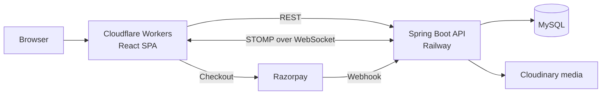

# KVG Trust Platform — Frontend

The web frontend of **[shanmukasaitrust.org](https://shanmukasaitrust.org)**, the live platform for K.V.G. Shanmuka Sai Charitable Trust. Donors give through Razorpay, volunteers register for programs, and trust admins publish events and stories through a built-in CMS. The platform has raised over ₹50,000 in donations.

Backend: [kvgshanmukhsaitrust-ops/trust-backend](https://github.com/kvgshanmukhsaitrust-ops/trust-backend) (Spring Boot, MySQL)

## What it does

- **Public site:** story, programs (education, environment, animal welfare, community), events gallery, impact counters, contact.
- **Donations:** Razorpay checkout, with donation receipts generated by the backend.
- **Volunteers and donors:** Google OAuth sign-in and role-based dashboards.
- **Admin CMS:** rich-text editor (Tiptap) with images and video, drag-and-drop ordering, image cropping.
- **Live notifications:** WebSocket/STOMP connection to the backend.

## How it fits together



## Stack

React 19 · Vite 7 · React Router 7 · Material UI · Tailwind CSS · Tiptap · Framer Motion · Axios · SockJS/STOMP · Playwright · Cloudflare Workers (Wrangler)

## Design decisions

- **Donations are recorded from Razorpay's server-side webhook,** not from what the browser reports, and the same event triggers the donation receipt.
- **Frontend and API deploy separately.** The SPA ships as static assets on Cloudflare Workers and the API runs on Railway, so the site stays up during backend deploys.
- **Real-time over STOMP.** Admin and volunteer notifications push over a WebSocket instead of polling.

## Run locally

```bash
npm install
npm run dev        # http://localhost:5173
npm run test:e2e   # Playwright end-to-end tests
npm run deploy     # build and deploy to Cloudflare
```

## Author

Built and maintained by [Rohith Vijay K](https://github.com/Rohith-vijay), sole engineer on the platform.
